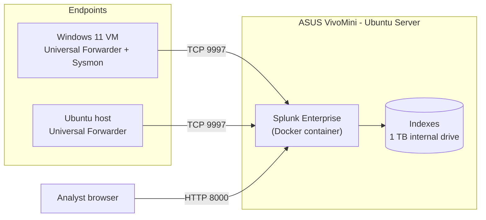

# Splunk Infrastructure SIEM Deployment

**Author:** Jason Moore
**Status:** 🚧 In progress
**Platform:** Splunk Enterprise (Docker) on ASUS VivoMini / Ubuntu Server
**Data sources:** Windows 11 (Security, PowerShell, Sysmon), Ubuntu (auth, syslog)

> Placeholders marked **TODO** are filled in with real values, output, and screenshots as the build progresses.

---

## Table of Contents

1. [Overview](#1-overview)
2. [Architecture](#2-architecture)
3. [Hardware and Resource Planning](#3-hardware-and-resource-planning)
4. [Splunk Server Installation](#4-splunk-server-installation)
5. [Licensing](#5-licensing)
6. [Index Design](#6-index-design)
7. [Windows Endpoint Onboarding](#7-windows-endpoint-onboarding)
8. [Linux Endpoint Onboarding](#8-linux-endpoint-onboarding)
9. [Validation](#9-validation)
10. [Dashboards](#10-dashboards)
11. [Detections](#11-detections)
12. [Troubleshooting Log](#12-troubleshooting-log)
13. [Lessons Learned](#13-lessons-learned)
14. [Next Steps](#14-next-steps)
15. [Repository Structure](#15-repository-structure)
16. [References](#16-references)

---

## 1. Overview

### Goal

Build a functional, self-hosted SIEM for the home lab using Splunk Enterprise, collect security telemetry from Windows and Linux endpoints, and use that data to build dashboards and detections mapped to MITRE ATT&CK.

### Objectives

- Deploy Splunk Enterprise as a Docker container on an existing Ubuntu Server host
- Design purpose-specific indexes with defined retention
- Onboard Windows 11 endpoints using the Universal Forwarder and Sysmon
- Onboard Linux endpoints using the Universal Forwarder
- Validate ingestion, field extraction, and license usage
- Build operational dashboards for endpoint and process activity
- Write, test, and document detections for common attacker techniques

### Skills Demonstrated

| Area | Skills |
|---|---|
| Deployment | Docker Compose, Linux administration, firewalling, Splunk configuration files |
| Data onboarding | Universal Forwarder, `inputs.conf` / `outputs.conf`, Windows audit policy, Sysmon |
| Search | SPL, `tstats`, `stats`, `timechart`, field extraction with `rex` |
| Detection engineering | Building, testing, and tuning detections; MITRE ATT&CK mapping |
| Documentation | Architecture diagrams, configuration management in Git, troubleshooting write-ups |

---

## 2. Architecture



### Hosts

| Hostname | OS | Role | IP |
|---|---|---|---|
| **TODO** | Ubuntu Server | Splunk indexer / search head (Docker) | **TODO** |
| **TODO** | Windows 11 | Endpoint: UF + Sysmon | **TODO** |
| **TODO** | Ubuntu | Endpoint: UF | **TODO** |

### Ports

| Port | Purpose | Exposure |
|---|---|---|
| 8000 | Splunk Web | Lab subnet only |
| 8089 | Splunk management (REST) | Host only |
| 9997 | Forwarder receiving | Lab subnet only |

### Design Decisions

- **Single-instance deployment.** One Splunk instance acts as both indexer and search head. This is appropriate for lab data volumes and keeps the footprint small.
- **Docker instead of native install.** The VivoMini already runs Docker for Project NOMAD, so a container keeps Splunk isolated, easy to upgrade, and fully described in a version-controlled `docker-compose.yml`.
- **Named volumes for persistence.** `/opt/splunk/etc` (configuration) and `/opt/splunk/var` (indexed data) live in Docker volumes so the container can be recreated without data loss.

---

## 3. Hardware and Resource Planning

### Host Specifications

Gathered with `free -h`, `nproc`, `df -h`, and `lscpu`.

| Resource | Value |
|---|---|
| CPU | **TODO** |
| RAM | **TODO** |
| Internal storage | 1 TB |
| External storage | WD My Book Duo (planned) |

### Sizing Notes

Splunk's production reference hardware far exceeds what a lab needs. For a single-instance lab ingesting well under 1 GB/day, 4+ cores and 8 GB+ of RAM is comfortable. Disk usage is roughly 50% of raw ingest after compression, so even 90 days of lab data fits easily on the internal drive.

**Existing workload check:** before deploying, port usage on the host was reviewed with `sudo ss -tulpn` to avoid conflicts with Project NOMAD services.

> **TODO:** Note any port conflicts found and how they were remapped.

---

## 4. Splunk Server Installation

### 4.1 Docker Compose

`configs/docker-compose.yml`:

```yaml
services:
  splunk:
    image: splunk/splunk:latest
    container_name: splunk
    hostname: splunk
    restart: unless-stopped
    environment:
      - SPLUNK_START_ARGS=--accept-license
      - SPLUNK_GENERAL_TERMS=--accept-sgt-current-at-splunk-com
      - SPLUNK_PASSWORD=${SPLUNK_PASSWORD}
      - TZ=America/Los_Angeles
    ports:
      - "<HOST_LAN_IP>:8000:8000"
      - "127.0.0.1:8089:8089"
      - "<HOST_LAN_IP>:9997:9997"
    volumes:
      - splunk-etc:/opt/splunk/etc
      - splunk-var:/opt/splunk/var

volumes:
  splunk-etc:
  splunk-var:
```

The admin password is stored in a `.env` file next to the compose file:

```bash
SPLUNK_PASSWORD=<strong-password-here>
```

`.gitignore`:

```
.env
```

### 4.2 Deploy

```bash
docker compose up -d
docker logs -f splunk
```

The container is ready when the logs show the Ansible provisioning run completing without failures. First startup takes several minutes.

```bash
docker ps --filter name=splunk
```

> **TODO:** Screenshot of `docker ps` showing the container as `healthy`.

### 4.3 Enable Receiving

In Splunk Web: **Settings → Forwarding and receiving → Configure receiving → New Receiving Port → 9997**.

Equivalent CLI from inside the container:

```bash
docker exec -it splunk sudo -u splunk /opt/splunk/bin/splunk enable listen 9997 -auth admin:<password>
```

### 4.4 Firewall

```bash
sudo ufw allow from <LAB_SUBNET>/24 to any port 8000 proto tcp
sudo ufw allow from <LAB_SUBNET>/24 to any port 9997 proto tcp
sudo ufw status numbered
```

> **Important:** Docker publishes ports by writing its own iptables rules, which **bypass UFW**. A `ufw allow` rule alone does not restrict access to a published container port. That is why the compose file binds ports to a specific host IP (and 8089 to `127.0.0.1` only). For stricter control, add rules to the `DOCKER-USER` iptables chain.

> **TODO:** Screenshot of the Splunk Web login page.

---

## 5. Licensing

| License | Daily ingest | Alerting | Authentication | Duration |
|---|---|---|---|---|
| Enterprise Trial | 500 MB | ✅ | ✅ | 60 days |
| **Developer** | 10 GB | ✅ | ✅ | 6 months, renewable |
| Free | 500 MB | ❌ | ❌ (no login, everyone is admin) | Unlimited |

**Choice:** **TODO** (Developer license recommended)

The Free license was rejected for this project because it disables scheduled alerts (needed for section 11) and removes authentication entirely, meaning anyone who can reach port 8000 has full admin access. The Splunk Developer License provides full Enterprise features at no cost for personal learning.

---

## 6. Index Design

Separate indexes keep searches fast (a search scoped to one index scans less data), make retention tunable per data type, and allow role-based access control later.

| Index | Data | Retention |
|---|---|---|
| `wineventlog` | Windows Security, System, PowerShell | 90 days |
| `sysmon` | Sysmon Operational | 90 days |
| `linux` | auth.log, syslog | 90 days |

`configs/indexes.conf`:

```ini
[wineventlog]
homePath   = $SPLUNK_DB/wineventlog/db
coldPath   = $SPLUNK_DB/wineventlog/colddb
thawedPath = $SPLUNK_DB/wineventlog/thaweddb
frozenTimePeriodInSecs = 7776000
maxTotalDataSizeMB = 20000

[sysmon]
homePath   = $SPLUNK_DB/sysmon/db
coldPath   = $SPLUNK_DB/sysmon/colddb
thawedPath = $SPLUNK_DB/sysmon/thaweddb
frozenTimePeriodInSecs = 7776000
maxTotalDataSizeMB = 20000

[linux]
homePath   = $SPLUNK_DB/linux/db
coldPath   = $SPLUNK_DB/linux/colddb
thawedPath = $SPLUNK_DB/linux/thaweddb
frozenTimePeriodInSecs = 7776000
maxTotalDataSizeMB = 10000
```

`frozenTimePeriodInSecs = 7776000` is 90 days. When data ages past that (or the index exceeds `maxTotalDataSizeMB`), Splunk deletes it, since no frozen archive path is configured.

Indexes were created via **Settings → Indexes → New Index**, which writes to the persistent `splunk-etc` volume. The file above documents the resulting configuration.

---

## 7. Windows Endpoint Onboarding

### 7.1 Audit Policy

The forwarder can only collect what Windows logs. These subcategories were enabled (many are already required by the DISA Windows 11 STIG):

```powershell
auditpol /set /subcategory:"Logon" /success:enable /failure:enable
auditpol /set /subcategory:"Security Group Management" /success:enable
auditpol /set /subcategory:"User Account Management" /success:enable /failure:enable
auditpol /set /subcategory:"Process Creation" /success:enable
auditpol /get /category:*
```

PowerShell Script Block Logging (Event ID 4104) enabled via Group Policy:
**Computer Configuration → Administrative Templates → Windows Components → Windows PowerShell → Turn on PowerShell Script Block Logging**

### 7.2 Sysmon

Sysmon was installed with a community configuration to generate high-fidelity process, network, and file telemetry.

```powershell
.\Sysmon64.exe -accepteula -i sysmonconfig.xml
Get-Service Sysmon64
```

**Config used:** **TODO** (e.g., SwiftOnSecurity `sysmon-config` or Olaf Hartong `sysmon-modular`)

### 7.3 Universal Forwarder Install

```powershell
msiexec.exe /i splunkforwarder-<version>-x64-release.msi `
  AGREETOLICENSE=Yes `
  RECEIVING_INDEXER="<SPLUNK_SERVER_IP>:9997" `
  SPLUNKUSERNAME=admin `
  SPLUNKPASSWORD="<forwarder-local-password>" `
  LAUNCHSPLUNK=1 `
  /quiet
```

### 7.4 Forwarder Configuration

`C:\Program Files\SplunkUniversalForwarder\etc\system\local\outputs.conf`:

```ini
[tcpout]
defaultGroup = lab_indexers

[tcpout:lab_indexers]
server = <SPLUNK_SERVER_IP>:9997
```

`C:\Program Files\SplunkUniversalForwarder\etc\system\local\inputs.conf`:

```ini
[WinEventLog://Security]
index = wineventlog
renderXml = true
disabled = 0

[WinEventLog://System]
index = wineventlog
renderXml = true
disabled = 0

[WinEventLog://Microsoft-Windows-PowerShell/Operational]
index = wineventlog
renderXml = true
disabled = 0

[WinEventLog://Microsoft-Windows-Sysmon/Operational]
index = sysmon
renderXml = true
disabled = 0
```

Restart the forwarder after changes:

```powershell
Restart-Service SplunkForwarder
```

### 7.5 Add-ons (on the Splunk server)

| Add-on | Purpose |
|---|---|
| Splunk Add-on for Microsoft Windows | Field extractions and CIM mapping for Windows event logs |
| Splunk Add-on for Sysmon | Field extractions for Sysmon XML events |

Installed via **Apps → Find More Apps**.

> **TODO:** Screenshot of a Sysmon Event ID 1 with extracted fields (`Image`, `CommandLine`, `ParentImage`).

---

## 8. Linux Endpoint Onboarding

### 8.1 Install

```bash
sudo dpkg -i splunkforwarder-<version>-linux-amd64.deb
sudo /opt/splunkforwarder/bin/splunk start --accept-license
sudo /opt/splunkforwarder/bin/splunk stop
sudo /opt/splunkforwarder/bin/splunk enable boot-start -systemd-managed 1 -user splunkfwd
sudo systemctl start SplunkForwarder
```

### 8.2 Log File Permissions

Recent forwarder versions run as the unprivileged `splunkfwd` user, which cannot read `/var/log/auth.log` by default. Adding it to the `adm` group fixes this:

```bash
sudo usermod -aG adm splunkfwd
sudo systemctl restart SplunkForwarder
```

### 8.3 Configuration

`/opt/splunkforwarder/etc/system/local/outputs.conf`:

```ini
[tcpout]
defaultGroup = lab_indexers

[tcpout:lab_indexers]
server = <SPLUNK_SERVER_IP>:9997
```

`/opt/splunkforwarder/etc/system/local/inputs.conf`:

```ini
[monitor:///var/log/auth.log]
index = linux
sourcetype = linux_secure
disabled = 0

[monitor:///var/log/syslog]
index = linux
sourcetype = syslog
disabled = 0
```

---

## 9. Validation

### 9.1 Forwarders Connected

```spl
index=_internal sourcetype=splunkd group=tcpin_connections
| stats latest(_time) AS last_seen BY hostname, sourceIp
| convert ctime(last_seen)
```

### 9.2 Data Arriving per Index / Host / Sourcetype

```spl
| tstats count WHERE index IN (wineventlog, sysmon, linux) BY index, host, sourcetype
```

> **TODO:** Screenshot of results.

### 9.3 Field Extraction Check

```spl
index=sysmon EventCode=1
| table _time host User ParentImage Image CommandLine
| head 10
```

### 9.4 License Usage

```spl
index=_internal source=*license_usage.log type=Usage
| eval MB = b / 1024 / 1024
| timechart span=1d sum(MB) AS daily_MB BY idx
```

> **TODO:** Record average daily ingest. Expected: well under the license limit.

---

## 10. Dashboards

### 10.1 Endpoint Overview

| Panel | SPL |
|---|---|
| Event volume by host | `\| tstats count WHERE index IN (wineventlog, sysmon, linux) BY _time span=1h, host \| timechart span=1h sum(count) BY host` |
| Successful vs failed logons | `index=wineventlog EventCode IN (4624, 4625) \| timechart span=1h count BY EventCode` |
| Top failed logon accounts | `index=wineventlog EventCode=4625 \| stats count BY TargetUserName \| sort -count \| head 10` |
| Linux SSH failures | `index=linux sourcetype=linux_secure "Failed password" \| timechart span=1h count BY host` |

### 10.2 Sysmon Activity

| Panel | SPL |
|---|---|
| Top processes | `index=sysmon EventCode=1 \| stats count BY Image \| sort -count \| head 20` |
| Rare parent/child pairs | `index=sysmon EventCode=1 \| stats count BY ParentImage, Image \| sort count \| head 20` |
| Outbound connections | `index=sysmon EventCode=3 \| stats count BY Image, DestinationIp, DestinationPort \| sort -count` |

Rare parent/child pairs are especially useful for hunting: legitimate software produces the same pairs repeatedly, so a one-off pair like `winword.exe → powershell.exe` stands out.

Dashboard source is exported to `dashboards/`.

> **TODO:** Screenshots of both dashboards.

---

## 11. Detections

Each detection was saved as a scheduled alert, then validated by generating the activity on a lab endpoint.

### 11.1 Windows Brute-Force Logon Attempts

| | |
|---|---|
| **ATT&CK** | T1110 – Brute Force |
| **Data source** | Security log, Event ID 4625 |
| **Schedule** | Every 5 minutes, last 15 minutes |

```spl
index=wineventlog EventCode=4625
| bin _time span=5m
| stats count AS failures, values(TargetUserName) AS accounts BY _time, host, IpAddress
| where failures >= 10
```

**Test** (from a Windows command prompt):

```cmd
for /L %i in (1,1,15) do net use \\localhost\IPC$ /user:fakeuser WrongPass123
```

> **TODO:** Result and screenshot. Note threshold tuning if needed.

### 11.2 Encoded PowerShell Execution

| | |
|---|---|
| **ATT&CK** | T1059.001 – PowerShell; T1027 – Obfuscated Files or Information |
| **Data source** | Sysmon Event ID 1 |
| **Schedule** | Every 5 minutes, last 15 minutes |

```spl
index=sysmon EventCode=1 (Image="*powershell.exe" OR Image="*pwsh.exe")
    (CommandLine="* -enc*" OR CommandLine="* -e *" OR CommandLine="*-EncodedCommand*")
| table _time host User ParentImage Image CommandLine
```

**Test:**

```powershell
$b = [Convert]::ToBase64String([Text.Encoding]::Unicode.GetBytes('Write-Host "detection test"'))
powershell.exe -EncodedCommand $b
```

> **TODO:** Result, screenshot, and any false positives found (some management agents use encoded commands legitimately).

### 11.3 User Added to Local Administrators

| | |
|---|---|
| **ATT&CK** | T1098 – Account Manipulation; T1136.001 – Create Account: Local Account |
| **Data source** | Security log, Event IDs 4720 and 4732 |
| **Schedule** | Every 15 minutes, last 15 minutes |

```spl
index=wineventlog EventCode=4732 TargetUserName="Administrators"
| table _time host SubjectUserName MemberSid TargetUserName
```

**Test** (elevated prompt), then clean up:

```cmd
net user labtest Lab!Test12345 /add
net localgroup Administrators labtest /add
net user labtest /delete
```

> **TODO:** Result and screenshot.

### 11.4 SSH Brute Force (Linux)

| | |
|---|---|
| **ATT&CK** | T1110.001 – Password Guessing |
| **Data source** | `/var/log/auth.log` |
| **Schedule** | Every 5 minutes, last 15 minutes |

```spl
index=linux sourcetype=linux_secure "Failed password"
| rex "from (?<src_ip>\d{1,3}(?:\.\d{1,3}){3})"
| stats count AS failures BY host, src_ip
| where failures >= 5
```

**Test:** attempt several SSH logins with a wrong password from another lab machine.

> **TODO:** Result and screenshot.

### Detection Summary

| Detection | ATT&CK | Triggered in test | Tuning needed |
|---|---|---|---|
| Windows brute force | T1110 | **TODO** | **TODO** |
| Encoded PowerShell | T1059.001, T1027 | **TODO** | **TODO** |
| Local admin added | T1098, T1136.001 | **TODO** | **TODO** |
| SSH brute force | T1110.001 | **TODO** | **TODO** |

---

## 12. Troubleshooting Log

Record each real issue in this format.

| # | Symptom | Root cause | Fix |
|---|---|---|---|
| 1 | **TODO** | **TODO** | **TODO** |

### Common Issues Checklist

| Symptom | Likely cause | Check |
|---|---|---|
| Container exits on startup | License/terms variable missing or changed | `docker logs splunk` |
| Forwarder not connecting | Receiving not enabled, wrong IP, or firewall | `splunk list forward-server` on the UF; `index=_internal` on the UF host |
| Security log missing | UF service account lacks permission | Forwarder `splunkd.log` for access errors |
| auth.log missing | `splunkfwd` not in `adm` group | `id splunkfwd` |
| Events in `main` instead of target index | Index not created before data arrived, or typo in `inputs.conf` | `\| tstats count WHERE index=main BY sourcetype` |
| Fields not extracted | Add-on missing or `renderXml` mismatch | Sourcetype should be `XmlWinEventLog` |
| Wrong timestamps | Time zone mismatch between host, container, and endpoint | Compare `_time` with `_indextime` |

---

## 13. Lessons Learned

> **TODO:** Complete after the build. Prompts:
> - What took longer than expected?
> - What would you configure differently from the start?
> - Which detection produced the most noise, and why?
> - What did the data reveal about normal endpoint behavior?

---

## 14. Next Steps

- [ ] Run Atomic Red Team tests and expand detection coverage
- [ ] Ingest Azure Activity and Entra ID sign-in logs
- [ ] Ingest Tenable STIG scan results and build a compliance dashboard
- [ ] Translate KQL threat hunts from the LAW-HuntPractice series into SPL
- [ ] Move cold buckets to the WD My Book Duo
- [ ] Set up a deployment server to manage forwarder configs centrally

---

## 15. Repository Structure

```
splunk-home-lab/
├── README.md
├── .gitignore
├── configs/
│   ├── docker-compose.yml
│   ├── indexes.conf
│   ├── windows/
│   │   ├── inputs.conf
│   │   └── outputs.conf
│   └── linux/
│       ├── inputs.conf
│       └── outputs.conf
├── detections/
│   ├── windows_bruteforce.spl
│   ├── encoded_powershell.spl
│   ├── local_admin_added.spl
│   └── ssh_bruteforce.spl
├── dashboards/
│   ├── endpoint_overview.xml
│   └── sysmon_activity.xml
└── images/
```

All IP addresses, hostnames, usernames, and credentials are sanitized before commit.

---

## 16. References

- Splunk Docker image documentation: `splunk/docker-splunk` on GitHub
- Splunk Universal Forwarder documentation (docs.splunk.com)
- Splunk Developer License program (dev.splunk.com)
- Microsoft Sysinternals Sysmon documentation
- SwiftOnSecurity `sysmon-config` / Olaf Hartong `sysmon-modular` on GitHub
- MITRE ATT&CK (attack.mitre.org)
- Splunk Security Content (research.splunk.com)
